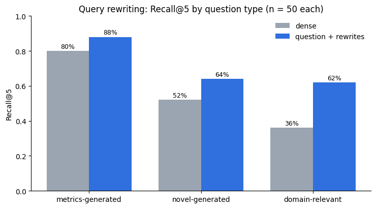
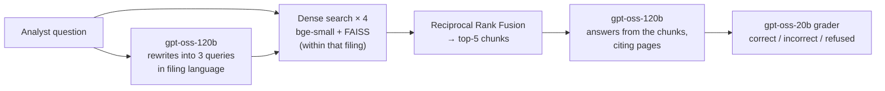
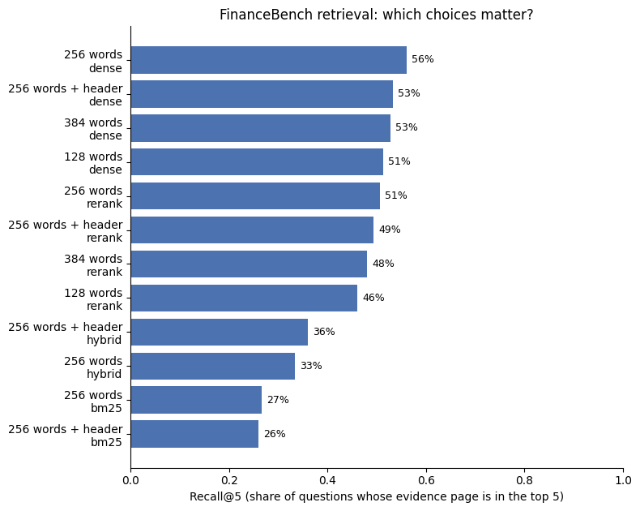
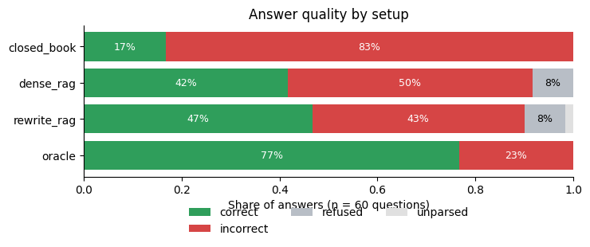

# Making RAG Work on Financial Filings

**Finding where retrieval falls short on FinanceBench, and closing the gap with LLM query rewriting.**

Anjana Anand · MS Data Science, University of Colorado Boulder · APPM 5750 final project

---

## Abstract

Large language models answer questions about company filings poorly on their own: with no documents, `gpt-oss-120b` answered only **17%** of FinanceBench questions correctly and never admitted uncertainty. Retrieval-augmented generation (RAG) fixes this only when search finds the right page, and a standard dense-retrieval pipeline found it for just **56%** of questions, falling to **36%** for analyst-style questions. My hypothesis was that analyst questions fail because they describe *concepts* ("capital-intensive") while filings list *line items* ("purchases of property, plant and equipment"). Having an LLM rewrite each question into filing language before searching raised retrieval recall to **71%** overall (**62%** on analyst questions, McNemar *p* < 0.001), while standard upgrades such as hybrid search and an off-the-shelf reranker did not help.



## Key findings

- **Query rewriting improved retrieval significantly:** Recall@5 rose from **0.56 to 0.71** on all 150 questions (32 questions gained, 9 lost; McNemar *p* < 0.001). Recall@10 rose from 0.67 to 0.85.
- **The gain landed where the diagnosis pointed:** analyst-judgment (`domain-relevant`) questions went from **0.36 to 0.62** (+14 / −1, *p* = 0.001).
- **Common RAG upgrades did not beat plain dense search:** hybrid BM25 + dense search scored 0.33, a cross-encoder reranker 0.49–0.51, and other chunk sizes 0.51–0.53, against the dense baseline of 0.56.
- **Retrieval is the main bottleneck for answers:** on a 60-question sample, accuracy went from 17% with no documents to 42% with dense RAG and 47% with rewriting. With the gold page given directly, it reached 77%. The 5-point gain from rewriting is not statistically significant at this sample size (*p* = 0.61).
- **Keeping the original question matters:** rewrites alone scored 0.66; adding the original question as a fourth search raised it to 0.71 and halved the questions lost (18 → 9).

## Pipeline



The **baseline** is the same pipeline without the rewrite step: one dense search with the original question, top-5 chunks, then generation.

## Data

[FinanceBench](https://github.com/patronus-ai/financebench) (Islam et al., 2023) is a benchmark of questions about real SEC filings, written by finance analysts. I used the public 150-question sample:

| | |
|---|---|
| Questions | 150, written by finance analysts |
| Question types | 50 each: `metrics-generated` (pull a figure from a statement), `domain-relevant` (analyst judgment), `novel-generated` (free-form) |
| Filings | 84 (10-K annual reports, 10-Q quarterly reports, 8-Ks, earnings releases) |
| Pages | 12,013 |
| Labels | Gold answer **and** gold evidence page for every question |

The gold evidence page is what makes this project possible: it lets retrieval be scored separately from answer quality.

**Preparation.** The notebooks download the questions and the 84 PDFs directly from the FinanceBench GitHub repository and cache them on Google Drive. Text is extracted page by page with PyMuPDF. Before scoring, I checked that FinanceBench's zero-indexed evidence page numbers match the extracted pages by locating each evidence passage in the extracted text. The data is not redistributed here; see [Licensing](#licensing).

## Methodology

### Chunking
Each page is split into 256-word chunks with a 32-word overlap. Chunks never cross a page boundary, so every chunk maps to exactly one page. This gives 31,870 chunks. The size was chosen to fit the embedding model's 512-token input limit: only 1.8% of 256-word chunks exceed it, against 17.9% of 384-word chunks.

### Dense retrieval (baseline)
Chunks and questions are embedded with [`BAAI/bge-small-en-v1.5`](https://huggingface.co/BAAI/bge-small-en-v1.5) (384 dimensions, normalized) and searched with a FAISS inner-product index, built separately for each filing. With unit-length vectors, inner product equals cosine similarity:

$$\text{sim}(q, d) = \frac{\mathbf{q} \cdot \mathbf{d}}{\lVert \mathbf{q} \rVert \, \lVert \mathbf{d} \rVert}$$

Search runs within the filing each question names (FinanceBench's "single-store" setting).

### Baselines tested (Notebook 02)
- **BM25** keyword search
- **Hybrid search:** BM25 and dense rankings combined with Reciprocal Rank Fusion
- **Cross-encoder reranking** of the top 30 candidates with [`BAAI/bge-reranker-base`](https://huggingface.co/BAAI/bge-reranker-base)
- **Chunk sizes** of 128, 256 and 384 words
- **Page-header tagging:** prepending each page's first 20 words to its chunks

### Extension: LLM query rewriting (Notebook 03a)
`gpt-oss-120b` rewrites each question into three short search queries in the vocabulary of a 10-K or 10-Q. It sees only the question, never the filing or the answer. The original question and the three rewrites are each searched (top 30), and the four ranked lists are merged with **Reciprocal Rank Fusion** (Cormack et al., 2009):

$$\text{RRF}(d) = \sum_{r \in \mathcal{R}} \frac{1}{k + \text{rank}_r(d)}, \qquad k = 60$$

Chunks that several searches agree on rise to the top; the top 5 are kept.

### Generation and grading (Notebook 03b)
`gpt-oss-120b` (via [Groq](https://console.groq.com), temperature 0, low reasoning effort) answers using only the retrieved chunks, cites pages, and replies "Insufficient information in the provided excerpts" when the excerpts aren't enough. `gpt-oss-20b` grades each answer against the analyst's answer as **correct**, **incorrect** or **refused**, following the FinanceBench paper's categories.

Four setups are compared on a stratified sample of 60 questions (20 per type, fixed seed): **closed book** (no documents), **dense RAG**, **rewrite RAG**, and **oracle** (the gold evidence pages given directly).

### Metrics and significance
- **Recall@k:** share of questions with at least one gold evidence page among the top *k* chunks.
- **MRR:** mean of 1 / rank of the first correct chunk (0 if none in the top 10).
- **Accuracy:** share of answers graded correct.
- **Bootstrap 95% confidence intervals:** 2,000 resamples of questions.
- **Exact McNemar test:** every method answers the same questions, so comparisons are paired. With *b* = questions gained and *c* = questions lost relative to the baseline, under the null hypothesis $b \sim \text{Binomial}(b + c, 0.5)$.

## Results

### Retrieval (all 150 questions)

| Method | R@1 | R@5 | R@10 | MRR |
|---|---|---|---|---|
| BM25 (keyword) | 0.147 | 0.267 | 0.307 | 0.198 |
| Hybrid (BM25 + dense, RRF) | 0.160 | 0.333 | 0.427 | 0.231 |
| Dense → reranker | 0.200 | 0.487 | 0.667 | 0.331 |
| Hybrid → reranker | 0.200 | 0.507 | 0.667 | 0.332 |
| Dense, 128-word chunks | 0.300 | 0.513 | 0.640 | 0.399 |
| Dense, 384-word chunks | 0.240 | 0.527 | 0.660 | 0.366 |
| Dense, 256 words + page header | 0.293 | 0.533 | 0.653 | 0.399 |
| **Dense, 256 words (baseline)** | 0.240 | **0.560** | 0.667 | 0.375 |
| Rewrites only | 0.313 | 0.660 | 0.800 | 0.462 |
| **Question + rewrites (extension)** | **0.347** | **0.713** | **0.853** | **0.508** |

Recall@5 with 95% bootstrap CI: baseline 0.56 [0.49, 0.64], extension 0.71 [0.64, 0.79].



### By question type (Recall@5, 50 questions each)

| Type | Dense | Question + rewrites | Gained / lost | McNemar *p* |
|---|---|---|---|---|
| domain-relevant (analyst judgment) | 0.36 | **0.62** | +14 / −1 | **0.001** |
| metrics-generated | 0.80 | 0.88 | +7 / −3 | 0.34 |
| novel-generated | 0.52 | 0.64 | +11 / −5 | 0.21 |

### Answer accuracy (60 questions, 20 per type)

| Setup | Correct | Incorrect | Refused / unparsed |
|---|---|---|---|
| Closed book | 0.17 | 0.83 | 0.00 |
| Dense RAG | 0.42 | 0.50 | 0.08 |
| Rewrite RAG | 0.47 | 0.43 | 0.10 |
| Oracle (gold pages) | 0.77 | 0.23 | 0.00 |



Rewrite RAG vs. dense RAG: +9 / −6 questions, McNemar *p* = 0.61. For reference, the FinanceBench authors report 50% correct for GPT-4-Turbo with a per-filing vector store and 85% in the oracle setting (different sample and human grading, so not directly comparable).

**Example.** Asked for PepsiCo's FY2021 capital expenditure (gold: $4.6 billion), the closed-book model answered "$7.1 billion" and attributed it to the cash flow statement it had never seen. With RAG, it answered "$4,625 million, i.e., $4.6 billion (page 62)."

## Reproducing the results

Everything runs on free tools: Google Colab, Google Drive and Groq's free API tier.

### Prerequisites
1. A Google account (for Colab and Drive).
2. A free [Groq API key](https://console.groq.com). In Colab, open the 🔑 **Secrets** panel, add it as `GROQ_API_KEY`, and enable notebook access. Never paste the key into a notebook.

### Steps
Run the notebooks in order. Each mounts Google Drive and caches its work in `MyDrive/financebench_rag/`, so later notebooks reuse it.

| Notebook | Runtime | What it does | Approx. time |
|---|---|---|---|
| [`01_data_and_baseline_retrieval`](notebooks/01_data_and_baseline_retrieval.ipynb) | T4 GPU | Downloads data, chunks, embeds, scores BM25 and dense search | ~10 min (5 min embedding) |
| [`02_retrieval_experiments`](notebooks/02_retrieval_experiments.ipynb) | T4 GPU | Hybrid search, reranker, chunk sizes, page headers | ~25 min first run |
| [`03a_query_rewriting`](notebooks/03a_query_rewriting.ipynb) | T4 GPU | LLM rewrites (~150 Groq calls), retrieval evaluation, significance tests; saves `contexts.json` | ~15 min |
| [`03b_answer_generation`](notebooks/03b_answer_generation.ipynb) | CPU | Generates and grades 240 answers | 1–2 days of free quota |

To open a notebook in Colab: **File → Open notebook → GitHub**, then paste this repository's URL. Set the runtime under **Runtime → Change runtime type**.

**Notes**
- **Free-tier limits.** Groq's free tier allows roughly 8,000 tokens per minute and about 200,000 tokens per day per model. The notebooks pace requests automatically, and every LLM response is cached to `llm_cache.jsonl` on Drive. If 03b stops with "daily limit reached", rerun it later and it resumes where it stopped.
- **Determinism.** Embeddings are cached to Drive and the LLM runs at temperature 0, so rerunning reproduces every reported metric. Notebook 02 was rerun from cached embeddings and matched exactly.
- **Pilot mode.** Notebook 01 has `PILOT = True` / `False` to try the pipeline on 10 filings first.

### Running locally
```bash
pip install -r requirements.txt
```
The notebooks use `google.colab` for Drive and secrets. To run locally, replace the Drive mount with a local folder and read `GROQ_API_KEY` from an environment variable.

## Repository structure

```
├── notebooks/
│   ├── 01_data_and_baseline_retrieval.ipynb   # data, chunking, BM25 vs dense baseline
│   ├── 02_retrieval_experiments.ipynb         # hybrid, reranker, chunk size, page headers
│   ├── 03a_query_rewriting.ipynb              # the extension + significance tests
│   └── 03b_answer_generation.ipynb            # answers, LLM grading, accuracy
├── results/
│   ├── retrieval_results.csv                  # all retrieval metrics (150 questions)
│   └── answer_results.csv                     # 240 generated answers with grades
├── figures/                                   # charts used in this README
├── docs/                                      # presentation slides and report
├── requirements.txt
├── LICENSE
└── README.md
```

## Limitations

- **Recall@k counts any gold page.** Questions that need several pages count as a hit when only one is found. For the 3M capital-intensity example, rewriting retrieved one of three gold pages.
- **Answers were graded by an LLM.** A spot check of 5 grades found one refusal labelled "incorrect". This does not change accuracy, but slightly inflates the incorrect rate.
- **Answer accuracy uses 60 questions** because of free-tier API limits, too few to confirm the 5-point gain from rewriting. Retrieval results use all 150.
- **No held-out set.** Methods were compared and the best chosen on the same 150 questions. The extension's effect is large (+32 / −9), but it has not been confirmed on new questions.
- **Off-the-shelf models only.** No finance-tuned embedder or reranker was tested, and a long-context baseline (the whole filing in the prompt) was not run.

## Future work
- Retrieve every evidence page for multi-page questions (for example, one result list per rewrite kept separately).
- Test a finance-tuned embedder or reranker.
- Score answers on all 150 questions, and compare against a long-context baseline.

## References
- Islam, P., Kannappan, A., Kiela, D., Qian, R., Scherrer, N., & Vidgen, B. (2023). *FinanceBench: A New Benchmark for Financial Question Answering.* arXiv:2311.11944.
- Cormack, G. V., Clarke, C. L. A., & Büttcher, S. (2009). *Reciprocal Rank Fusion outperforms Condorcet and individual rank learning methods.* SIGIR.
- Xiao, S., Liu, Z., Zhang, P., & Muennighoff, N. (2023). *C-Pack: Packaged Resources To Advance General Chinese Embedding* (BGE models). arXiv:2309.07597.
- Johnson, J., Douze, M., & Jégou, H. (2019). *Billion-scale similarity search with GPUs* (FAISS). IEEE Transactions on Big Data.
- OpenAI (2025). *gpt-oss-120b & gpt-oss-20b* model card.

## Licensing
Code in this repository is released under the [MIT License](LICENSE). FinanceBench is released by Patronus AI under CC BY-NC 4.0. The questions and PDFs are downloaded from its repository at run time and not redistributed here. `results/answer_results.csv` includes FinanceBench questions and gold answers for the 60 sampled questions, shared for non-commercial research use with attribution.
